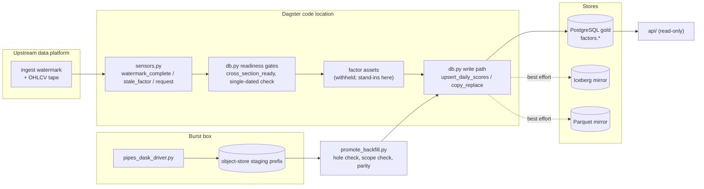

# Architecture notes

How the shipped pieces fit together. File names are relative to the repo root.

## 1. The write path (`dagster/meridian_pipeline/db.py`)

Everything that lands in `factors.daily_scores` goes through one of three
functions: `upsert_daily_scores` (row-oriented, the daily assets),
`copy_replace_daily_scores` (bulk `COPY`, the burst promote) and
`stage_daily_scores_rows` / `apply_staged_daily_scores` (stage first, apply
under the lock). They share these rules:

- **Scoped delete-replace.** A rerun deletes the rows it owns for each
  `(score_date, factor_name)` and re-inserts, in one transaction, so a universe
  that shrank leaves no orphans. `owned_factors` declares the exact set a caller
  owns; the delete is scoped to those names across every group, never wider.
- **Refusing a silent hole.** The delete runs before the insert, so an owned
  factor with no rows in the payload would be deleted without replacement. The
  default is to refuse that write; batch promoters that hold one scope across
  many partitions opt out explicitly. For a declared `replace_date_range`, the
  payload is compared with the real trading calendar and a missing interior date
  is refused unless the caller says the empty date is intended.
- **Advisory locks.** Each write takes a shared lock on the table's range key
  and an exclusive lock per score date, always range key first and dates
  ascending, so the lock graph is acyclic. The number of dates per transaction is
  bounded (each lock occupies a slot in the shared lock table) and the wait is
  bounded by a configurable `lock_timeout`.
- **Schema bootstrap with deadlock retry.** `ensure_schema` is idempotent DDL
  that many run pods may issue at once; it retries on deadlock with backoff.
- **No future dates, NaN to NULL.** `assert_score_date_not_future` and the NaN
  normalisation exist because both failure modes are silent.
- **Best-effort mirrors.** After the PostgreSQL commit the rows are mirrored to
  Parquet and Iceberg. PostgreSQL is authoritative and the mirrors never raise;
  the burst promote checks the mirror is ready once up front instead.

### Lineage

`lineage.py` and `db.record_write_campaign` / `finish_write_campaign` stamp a
`campaign_id` on every row. The invariant that governs the code is that lineage
is additive: a capability probe returns false until the migration is applied, and
until then every writer emits SQL byte-identical to its pre-lineage form. Only a
*successful* probe is cached, and a probe error is re-raised rather than letting
a writer re-insert unstamped rows.

## 2. Readiness gates

`cross_section_ready` and `trigger_cross_section_ready` decide whether a date may
be scored: watermark first (the upstream platform marks a trade date complete),
falling back to a coverage-ratio predicate against the trailing median.
`assert_cross_section_single_dated` refuses a cross-section that silently mixes
as-of dates, which is what a read during an upstream rewrite looks like.
`assert_universe_coverage` guards the size of the scored universe.

## 3. Hygiene and checks

- `ohlcv_hygiene.py`: a floor on bogus or illiquid prints, a delisting guard and
  a staleness fallback for tickers that stopped printing.
- `adj_close_guard.py`: a same-row ratio test that catches one poisoned
  `adj_close` which finite-value gates pass straight through.
- `splice_guard.py`: protection against ticker-symbol reuse blending two
  companies into one rolling window.
- `checks/ohlcv_contract_checks.py`: the one *blocking* check, a read-boundary
  contract on the price tape. `checks/ret1d_checks.py` is a tripwire for
  upstream `ret_1d` corruption. `checks/trading_day_checks.py` sweeps every
  scored table for non-trading dates, because a writer that derives its partition
  set from gold reproduces whatever junk dates gold already carries.
- `checks/alerting.py` and `notify.py`: failed checks page once per (check,
  partition); the transport is fail-open and refuses to send under pytest.

## 4. Burst ship-back (`scripts/burst/`)

Three planes: Dagster on the cluster (control), Dagster Pipes over object storage
(bridge), Dask on a burst box (compute).

1. `pipes_dask_driver.py` fans partitions out to workers, which write score
   parquet to a **staging prefix**. The box never writes gold.
2. Per-partition sentinels make a crashed run resumable with the same run id.
3. `promote_backfill.py` (control plane) refuses to promote unless: the owned
   scope in the run manifest agrees with the staged payload in both directions;
   every date the kernel undertook is present (hole check); live-only factors
   that cannot be reproduced for a historical date are carried out of the delete
   scope; coverage does not regress. It then delete-replaces through
   `copy_replace_daily_scores` and re-reads a sample (always including the last
   partition) to prove gold equals the staged rows.
4. `verify_promoted_range.py` independently certifies a promoted range against
   the staged payload without reading the promote's own campaign rows.
5. `promote_replay_out.py` does the same for replayed output under one explicit
   campaign, and refuses an incomplete box run (manifest, directory listing and
   per-date row counts must agree exactly).

`ingest_window.py` is a pure-stdlib preflight that refuses to start a campaign
while the upstream nightly ingest is running.

## 5. Lakehouse and mirrors

- `lakehouse.py`: Iceberg warehouse access through pyiceberg with an OIDC bearer,
  month-partitioned delete-replace writes with commit retry.
- `parquet_io.py`: a DuckDB read path over Parquet / Iceberg with a PostgreSQL
  fallback, recency-first duplicate-key precedence, and the OHLCV read contract.
- `checked_mirror.py` + `mirror_digest.py`: a PostgreSQL to Iceberg mirror that
  compares an exact, order-independent per-date content digest on both sides
  (never sums of values) and fails closed.
- `lakehouse_parity.py`: cheap per-date aggregate parity monitor.
- `gold_pg_sync_asset.py`: one-way, scoped promotion of a finalised Iceberg batch
  into PostgreSQL.

## 6. Sensors

`sensors.py` ships the sensors that drive and watch the daily two-phase run:
`watermark_complete_sensor` (primary trigger), `stale_factor_sensor` (safety net),
`request_sensor` (API-submitted dates), `core_complete_sensor` (phase-1 to
phase-2 bridge with an age gate and a JSON cursor; deliberately not a
`multi_asset_sensor`, whose event cap deadlocks partial-completion patterns),
`ldp_ohlcv_upstream_sensor`, `composite_cache_warm_sensor`,
`iceberg_gold_sync_sensor`, `backfill_completion_sensor`, `asset_check_alert_sensor`,
`ntfy_run_failure_sensor` and `checked_score_mirror_sensor`.

## 7. Read API

`api/main.py` mounts four routers. Routes are authenticated except `/health`;
cache control needs an admin token. The response contract is frozen: fields are
added, never renamed or dropped. `api/cache.py` is a TTL cache with a size bound
(`API_SCORE_CACHE_MAX_ENTRIES`) and per-date eviction for the cache-warm route.
